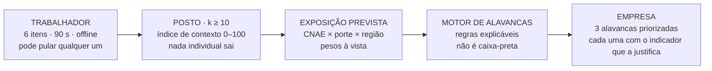
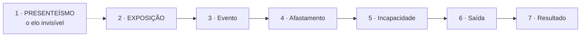

# Cheers — Hackathon+ SESI Saúde 2026

> **O SESI mede o risco que o trabalhador corre. Não mede o trabalho que causa o risco.**

Repositório da equipe **Cheers** (5 pessoas) para o **Hackathon+ SESI Saúde** — SESI Bahia + Grupo Rede+, Salvador, **14 e 15 de novembro de 2026**.

```
Evento       Hackathon+ SESI Saúde 2026 · SESI Bahia + Grupo Rede+
Desafio     Sustentabilidade dos modelos assistenciais de saúde (Anexo I)
Entrega      Protótipo funcional + pitch de 3 minutos (§6.3)
Nota         Final = (Pitch × 6) + (Protótipo × 4) (§8)
Time         Cheers · 5 pessoas
Status       Pesquisa e roteiro · nenhum código de produto antes do reveal
Licença      Sem licença — todos os direitos reservados (§10.8)
```

**Se você é do time:** vá direto para **[O que fazer até sexta 06/11](#prazo)** e para **[As 5 regras que ninguém pode quebrar](#regras)**.

---

## A lacuna, com o número

O **ASSTI** — o instrumento oficial de saúde do trabalhador do SESI — tem **7 dimensões**. O relatório que o SESI publicou em setembro de 2026 mediu **6** e **declarou a 7ª sem analisar**:

> *"Os resultados focalizam em **seis das sete dimensões** do Sistema de Avaliação em Saúde e Segurança do Trabalhador da Indústria — ASSTI […] **Não foram analisados, os fatores de redução da produtividade** por não estarem alinhados ao propósito do presente estudo."*
> — *VigIndústria Brasil 2026*, p. 16 `[fato]`

A 7ª dimensão — **fatores de redução da produtividade** — é o presenteísmo: por que o trabalhador produz menos **sem faltar**. Ela é a **4ª dimensão do Anexo I** (participação das pessoas) com outro nome. E está **pronta e validada** (CR = 0,863; AVE = 0,581) — sem um único item que a pergunte.

| Evidência | Valor | Fonte |
|---|---|---|
| Dimensões do ASSTI declaradas e nunca analisadas | **1 de 7** | VigIndústria p. 16 `[fato]` |
| Itens de autonomia, decisão, propósito ou segurança psicológica no questionário (p. 110–119) | **0** | VigIndústria, Anexo I `[fato]` |
| Validade psicométrica da 7ª dimensão | CR 0,863 · AVE 0,581 | VigIndústria p. 21 `[fato]` |
| Recomendação do próprio relatório: *"fortalecer competências de liderança, comunicação aberta e ambiente psicologicamente seguro"* — **sem nenhum item que meça isso** | 1 recomendação órfã | VigIndústria p. 98 `[fato]` |
| Trabalhadores que faltaram **≥1 dia/semana** por saúde · **≥3 dias** | 20,0% · 6,5% | SESI/ASSTI, *Estilo de Vida, Saúde e Produtividade*, n = 123.355 `[fato]` |
| Comunicação de prevenção considerada **suficiente** · em **micro/pequenas empresas** | 65,6% · 56,2% | VigIndústria, T36, p. 95 `[fato]` |
| Base populacional do relatório | 57.952 trabalhadores · 825 empresas · 33 indicadores | VigIndústria `[fato]` |
| Custo do fim da cadeia | 106 mi de dias perdidos (2016–2025) · 4,1 mi de afastamentos no INSS (2025, +17,1%) | CANPAT · INSS `[fato]` |

> **A fonte do desafio pede a coisa que o instrumento não mede.** O Anexo I do regulamento exige modelos que fortaleçam *"autonomia, participação, bem-estar e senso de propósito"*. O instrumento que a indústria brasileira usa para medir saúde do trabalho tem **zero** itens nessa dimensão. Não é leitura nossa — está escrito na fonte.

---

## A proposta: **SINAL** — *o sinal que antecede a falta*

> *"Hoje o SESI mede o risco que o trabalhador corre. Não mede o trabalho que causa o risco. O SINAL dá ao trabalhador uma voz mensurável e devolve à empresa, em alavancas priorizadas, o que mudar no trabalho — antes da falta."*

**O ciclo, em três passos:**



**Por que funciona, no dia a dia:** o trabalhador recebe o convite pelo canal que **já existe** (Plataforma Viva+, rede credenciada do SESI-BA), responde 6 itens em 90 s no celular **offline**, e recebe de volta **as 2 alavancas que são dele** — não um relatório. Só quando o posto tem **k ≥ 10** o agregado é liberado; abaixo disso, não sai nada — nem para o SESI, nem para a empresa. É uma trava de privacidade, não um parâmetro.

**Os 6 itens** vêm do referencial de risco psicossocial mais validado que existe — as *HSE Management Standards* (Reino Unido, 2000) —, adaptedos ao português brasileiro. A escolha não é estética: **demanda** (OR 1,57 para ausência) e **apoio** (OR 0,58 — reduz) têm efeito publicado; autonomia genérica, não.

| # | Item | A pergunta como o trabalhador lê | O que mede |
|---|---|---|---|
| 1 | **Demanda** | *"A quantidade de trabalho que me é pedida cabe no meu tempo."* | Sobrecarga, ritmo, falta de recursos |
| 2 | **Controle** | *"Tenho margem para decidir como faço o meu trabalho."* | Autonomia sobre método e sequência |
| 3 | **Apoio** | *"Recebo apoio de colegas e chefia quando preciso."* | Capital social no posto |
| 4 | **Reconhecimento** | *"O meu trabalho é reconhecido."* | Retorno do esforço |
| 5 | **Propósito** | *"O meu trabalho faz sentido para mim."* | Sentido de propósito |
| 6 | **Segurança** | *"É seguro falar o que penso no trabalho."* | Segurança psicológica |

**A lacuna de ciclo** — a cadeia da saúde ocupacional tem 7 elos, e o instrumento oficial cobre só do 3º ao 6º. O **1º (presenteísmo) não existe em sistema nenhum** — e é no 1º e no 2º que a predição funciona, antes do evento:



**Escopo do MVP (32 h, com plano de corte declarado):** Escuta (6 h) · Plano do trabalhador (8 h) · Exposição prevista (8 h) · Motor de alavancas (6 h) · Export FHIR/eSocial (4 h). A ordem de sacrifício é **Export → Escuta → Plano → Exposição**; o **motor de alavancas nunca é cortado**.

Detalhe completo em [`docs/04-proposta.md`](docs/04-proposta.md) · justificativa em [`docs/09-por-que-esta-proposta.md`](docs/09-por-que-esta-proposta.md).

---

## O que prometemos — e o que **não** prometemos

| promised | Não prometemos | Por quê |
|---|---|---|
| **Dias expostos por posto** (antes e depois) | Redução de absenteísmo em % | A base são estudos observacionais: associa, não prova causal `[fato]` |
| **Índice de contexto de trabalho** por posto (0–100) | ROI ou economia em R$ | Em ensaio randomizado (n = 32.974) o ROI de absenteísmo foi **−49%**. A literatura de "1 real economizado por 2 investidos" é artefato de desenho de estudo `[fato]` |
| **3 alavancas priorizadas** por posto, cada uma citando o indicador nacional que a justifica | "Manutenção preditiva" | O Anexo I rejeita a leitura de IoT industrial. É previsão de desfecho de saúde do trabalho |
| **Mudança organizacional** medida em duas ondas (90 dias) | R$ 468 bi atribuído ao presenteísmo | Esse número é de **doenças e acidentes** de trabalho, não de presença improdutiva `[fato]` |
| O antes/depois que o relatório do SESI pede na p. 100 | Um "dashboard de SST" a mais | SOC, SGG, WOTY e o próprio ASSTI já vendem isso |

**O impacto real, em uma frase honesta:**

> *"A gente não promete reduzir absenteísmo. A gente promete instrumentar a dimensão que o Anexo I pede e que não existe, entregar 3 alavancas acionáveis por posto, e criar o antes/depois em dias expostos que hoje não existe — que é o pré-requisio de qualquer promessa de economia, e exatamente o que o relatório do SESI pede na p. 100."*

---

## 📄 O dossiê em PDF — 58 páginas, A4, sumário clicável

A consolidação de **tudo que a pesquisa produziu fora do WhatsApp**. É o material pronto para enviar no grupo.

| Doc | Arquivo | Páginas | O que responde | Quem lê |
|---|---|---|---|---|
| **01** | [`01-horizonte-de-trabalho.pdf`](docs/relatorios/01-horizonte-de-trabalho.pdf) | 12 | O mapa do que exploramos, **o delta em relação ao grupo**, as decisões em aberto, o calendário real | **Todos** — é a entrada |
| **02** | [`02-nucleo-e-gaps.pdf`](docs/relatorios/02-nucleo-e-gaps.pdf) | 15 | A tese, a 7ª dimensão do ASSTI, os **4 gaps**, o mecanismo e o **impacto honesto** | **Todos** — é o que a gente vai defender |
| **03** | [`03-evidencia-mercado-regulacao.pdf`](docs/relatorios/03-evidencia-mercado-regulacao.pdf) | 18 | Os 33 indicadores, a base científica, o **mapa de preços** dos concorrentes, o escudo regulatório, as metas ODS | Quem for **contestar número** |
| **04** | [`04-kit-13-11-e-build.pdf`](docs/relatorios/04-kit-13-11-e-build.pdf) | 13 | O **protocolo de 90 min**, os 5 kernels, as **32 h** de build, os 8 riscos, o checklist do pitch | **Todo o time na noite de 13/11** |

O HTML-fonte fica ao lado de cada PDF. Para regerar e verificar: [`docs/relatorios/README.md`](docs/relatorios/README.md).

---

## Mapa do repositório

O índice completo, **ordenado pelo caminho de leitura** (e não pela ordem em que os arquivos foram criados), está em [`docs/README.md`](docs/README.md).

| Caminho | Documento | Papel |
|---|---|---|
| **A · Entender a tese** | [`docs/04-proposta.md`](docs/04-proposta.md) | **A proposta canônica.** O que a gente constrói, o escopo e a ordem de corte |
| | [`docs/09-por-que-esta-proposta.md`](docs/09-por-que-esta-proposta.md) | Os 4 gaps empilhados e o impacto honesto em 5 níveis de confiança |
| | [`docs/00-portfolio-oportunidades.md`](docs/00-portfolio-oportunidades.md) | As 10 oportunidades com score de viabilidade |
| | [`docs/03-tese-preditiva.md`](docs/03-tese-preditiva.md) | A cadeia de 7 elos e o enquadramento TAM/SAM/SOM |
| **B · Verificar um número** | [`data/vigindustria-2026.md`](data/vigindustria-2026.md) | **Os 33 indicadores** com prevalência, IC 95% e página/tabela. É onde se busca o número |
| | [`docs/pesquisa/01-mapa-competitivo.md`](docs/pesquisa/01-mapa-competitivo.md) | 11 concorrentes em 5 camadas, com preço e a lacuna que cada um deixa |
| | [`docs/viabilidade-stack-dados-regulatorio.md`](docs/viabilidade-stack-dados-regulatorio.md) | Normas, 9 datasets públicos e o custo em horas de setup de cada stack |
| **C · Entender as regras** | [`docs/07-alavancas-regulamento.md`](docs/07-alavancas-regulamento.md) | As 7 alavancas de pontuação e as restrições R1–R14 |
| | [`docs/06-ods-metas.md`](docs/06-ods-metas.md) | As metas 3.8, 3.d, 9.4 e 9.5 com o **texto oficial verificado** |
| | [`docs/05-inscricao-formulario.md`](docs/05-inscricao-formulario.md) | As **22 perguntas** do formulário, com o texto pronto de cada campo |
| | [`AGENTS.md`](AGENTS.md) | O mapa de trabalho: correções vivas, decisões em aberto, cronograma |
| **D · A noite de 13/11** | [`docs/08-plano-90min.md`](docs/08-plano-90min.md) | O **protocolo de 90 min**: cronômetro, divisão por pessoa, grade de 4 testes |
| | [`docs/10-mapa-de-build-32h.md`](docs/10-mapa-de-build-32h.md) | As **32 h hora a hora**: 2 turnos, CORTE 1 e CORTE 2, 8 riscos, freeze |
| | [`docs/11-perguntas-para-a-organizacao.md`](docs/11-perguntas-para-a-organizacao.md) | One-pager imprimível com as **8 perguntas** para a live de 12/11 |
| **E · Pitch** | [`pitch/roteiro-3min.md`](pitch/roteiro-3min.md) | O pitch **palavra por palavra**, plano B e 8 perguntas de banca |
| | [`pitch/demo.html`](pitch/demo.html) | A **demo funcional offline** — abre com duplo clique, sem rede. Tela "Modo Pitch" com cronômetro |
| | [`pitch/slide-impacto.html`](pitch/slide-impacto.html) | O slide único de impacto, A4 paisagem, imprimível |
| | [`pitch/apresentacao-interna.md`](pitch/apresentacao-interna.md) | A apresentação de 10 min para o time, sem contexto prévio |

**O regulamento** (11 p. + Anexo I) está na raiz: [`Regulamento Hackathon SESI Saude 2026.pdf`](<Regulamento Hackathon SESI Saude 2026.pdf>). É a fonte de verdade — quando o regulamento e o grupo divergirem, o regulamento vence.

---

<a id="prazo"></a>

## 👥 Time — o que fazer até sexta 06/11

> ⚠️ **08/11 (o fim oficial das inscrições) é um DOMINGO.** O prazo real é **sexta 06/11**. São **5 dias úteis**.

| Quem | O quê | Onde está o texto |
|---|---|---|
| **Os 5** | **Preencher a inscrição individual** — cada um com a sua voz (5 respostas iguais = spam; §4.1.2 avalia "conhecimento na temática") | [`docs/05-inscricao-formulario.md`](docs/05-inscricao-formulario.md) §3 |
| **Esteves** | **Decidir o slot de DESIGN** e marcar "Design" no formulário (sem isso a equipe aparece com 3 dos 4 perfis do §5.3) | [`docs/05-inscricao-formulario.md`](docs/05-inscricao-formulario.md) §3.3 |
| **Matheus + Omena** | **Nome do produto** — "SINAL" é a recomendação; checar INPI antes | [`docs/04-proposta.md`](docs/04-proposta.md) §1 |
| **Time** | **Quem é o líder** (§9.5 — o prêmio cai na conta de uma pessoa só) | — |
| **Time** | **Quem responde o e-mail de confirmação em 24 h** (pode cair no fim de semana) | — |

**Os 5 com o mesmo nome de equipe: `Cheers`.** Sem exceção (§5.2).

### Quem faz o quê

| Membro | Papel | Slot §5.3 |
|---|---|---|
| **Matheus Mendes** | Coordenação do repo e do time · tech, front e UX · **Product Owner** | TI (1/2) |
| **luquinhas** | Tech · velocidade de prototipagem | TI (2/2) |
| **Omena** | Visão de produto e de negócio | **Gestor** |
| **Moisés** | Especialista · informática em saúde, IA no atendimento médico · **speaker do pitch** | **Especialista** |
| **Gabriel Esteves** | Articulação com o SESI/MES · validação clínica | **Designer** ⚠️ |

### Só leia 3 coisas

| # | Documento | Por quê |
|---|---|---|
| 1️⃣ | [`pitch/apresentacao-interna.md`](pitch/apresentacao-interna.md) | A proposta em 10 min, sem contexto prévio. **Comece por aqui** — é a apresentação para o time |
| 2️⃣ | [`docs/05-inscricao-formulario.md`](docs/05-inscricao-formulario.md) | As 22 perguntas do formulário + **o texto pronto do seu campo**. É a sua tarefa até sexta |
| 3️⃣ | [`docs/09-por-que-esta-proposta.md`](docs/09-por-que-esta-proposta.md) | A justificativa completa: os 4 gaps, a 7ª dimensão na prática, o impacto real e por que não é agrotech |

---

<a id="regras"></a>

## As 5 regras que ninguém pode quebrar

1. **Não prometer economia.** Em ensaio randomizado o ROI de absenteísmo é **−49%**. A gente promete **medir** dias expostos, antes e depois.
2. **Não dizer "manutenção preditiva".** O Anexo I rejeita a leitura de IoT industrial. É previsão de desfecho de saúde do trabalho.
3. **Não atribuir os R$ 468 bi (4% do PIB) ao presenteísmo.** Esse número é de doenças e acidentes de trabalho.
4. **Não tocar em código de produto antes de 14/11.** §7.3 (o desafio só aparece na abertura) + §11.8 (vantagem indevida desclassifica o grupo).
5. **Nada de dado individual de trabalhador.** Agregado com **k ≥ 10**, sem identificação, sem ASO, sem decisão de emprego.

---

## Por que o repo tem tanta coisa

O §7.3 do regulamento diz que o **detalhamento do desafio só é apresentado na abertura** (13/11, 18h30). Chegar com uma solução travada quebra o nivelamento entre as 12 equipes — e a seleção é julgada pelo formulário, **antes** do desafio existir.

Por isso o repo guarda o **kit de mapeamento**, não a solução:

- [`docs/02-cruzamento-whatsapp.md`](docs/02-cruzamento-whatsapp.md) — a grade das 4 dimensões do Anexo I + 5 bifurcações
- [`docs/08-plano-90min.md`](docs/08-plano-90min.md) — como absorver o desafio em 90 min e travar o escopo
- [`docs/01-produtos-brainstorm.md`](docs/01-produtos-brainstorm.md) — as 10 ideias e o porquê das 3 escolhidas

**Em 13/11 às 18h30 a gente descobre o tema real.** Até lá: inscrição, slide e ensaio.

---

## Como contribuir

As regras completas estão em [`CONTRIBUTING.md`](CONTRIBUTING.md). O essencial:

**Um tema por commit. Conventional Commits, em português do Brasil, sem acentos.**

```
docs: adiciona a grade das 4 dimensoes do Anexo I
fix: inverte o sinal do indicador de 65,6%
pitch: ajusta o bloco de viabilidade do roteiro de 3 min
```

**Fluxo:** nada de commit direto na `main`.

```bash
git switch -c feat/mapa-de-build
# ... commits ...
git push -u origin feat/mapa-de-build
# abre o PR pelo template em .github/PULL_REQUEST_TEMPLATE.md
```

**Checklist antes do PR:**

- [ ] Toda afirmação nova tem marca de evidência (`[fato]`, `[hipótese]`, `[a confirmar]`, `§N`).
- [ ] Todo número tem fonte (link, data, página/tabela).
- [ ] Nenhuma promessa de economia, ROI ou % de absenteísmo.
- [ ] Nenhuma ocorrência de "manutenção preditiva" como tese, nem "ODS 2" para saúde (é **ODS 3**).
- [ ] Varredura de caracteres não latinos rodada.
- [ ] Links quebrados conferidos.

**Padrão de evidência** (vale para todo o repositório):

| Marca | Significado |
|---|---|
| `[fato]` | Verificável, com link e data |
| `[hipótese]` | Leitura nossa, sujeita a teste |
| `[a confirmar]` | Depende de confirmação da organização |
| `§N` | Vem do regulamento |

> **Agente que não sabe pesquisa e cita: não chuta número clínico nem estatística de mercado.**

---

## Padrão de evidência e fontes primárias

Todo número deste repositório é rastreável até a fonte original. Os PDFs estão versionados em [`docs/sources/`](docs/sources/) — com a **URL pública de cada um** e a regra de uso em [`docs/sources/README.md`](docs/sources/README.md).

| Fonte | O que sustenta |
|---|---|
| **VigIndústria Brasil 2026** (SESI + CN-SESI + Ministério da Saúde, 119 p.) | A 7ª dimensão e o "zero de itens" · CR/AVE · os 33 indicadores · 65,6% |
| **ASSTI — *Estilo de Vida, Saúde e Produtividade*** (n = 123.355) | Absenteísmo populacional: 20,0% e 6,5% |
| **CANPAT 2025** (Auditores-Fiscais do Trabalho) | 106 mi de dias perdidos · 6,4 mi de acidentes |
| **INSS 2025** | 4,1 mi de afastamentos (+17,1%) |
| **CN-SESI — PAO 2026 (retificado)** | 2.738.306 vidas ativas na Plataforma Viva+ · objetivo estratégico |
| **ANS — *Panorama Saúde Suplementar*** | Contexto de mercado e modelo de negócio |
| **IESS TD nº 118/2026** | Planos coletivos empresariais |
| **CFM Res. nº 2.454/2026** | O escudo regulatório: IA em medicina, **baixo risco** no Anexo II, I |
| **Regulamento 2026** (11 p. + Anexo I) | §2.1, §3.6, §4.1.2, §5.3, §6.3, §7.2, §7.3, §8, §9.5, §10.8, §11.2, §11.8 |

**Regra de uso dos dados:** nada de dado individual de trabalhador — todo uso é agregado (k ≥ 10) ou sintético (LGPD art. 11; NR-7; nada de ASO).

---

## Direitos

Este repositório **não tem arquivo de licença** — o padrão do GitHub é **todos os direitos reservados**, e é a escolha coerente com o §10.8 do regulamento, que deixa os direitos autorais com os criadores.

**Para liberar em MIT (ou outra), quando o time decidir:**

1. **No GitHub:** botão **Add a license** no topo da página do repositório — ele cria o `LICENSE` e um commit na `main`.
2. **Na linha de comando:** `gh api -X PUT repos/matheusmendes720/cheers-hackathon-sesi-saude-2026/license -f license=mit`

**O que o regulamento do desafio já faz, e que a gente não pode desfazer:**

- **§10.1–10.3 — cessão de imagem e voz:** gratuita, definitiva, irrevogável, sem limite territorial ou temporal, incluindo **o nome e as características da solução**. Por isso o nome do produto ("SINAL") foi checado antes de ir para o formulário.
- **§10.8 — direitos autorais:** continuam com os criadores. A equipe vencedora *pode* ceder a propriedade intelectual ao SESI-BA na submissão, se não quiser desenvolver o projeto. **Não assinar cessão de PI sem decisão explícita do time.**
- **§10.6 — originalidade:** os participantes assumem responsabilidade total pela originalidade da solução.

**Dados pessoais:** [`chat.md`](chat.md) e [`chat.txt`](chat.txt) são o export do grupo de WhatsApp da equipe e [`AGENTS.md`](AGENTS.md) traz a lista do time — ambos contêm **números de telefone de membros da equipe**. Se o time preferir removê-los do histórico público, é uma reescrita de histórico (o repositório ainda é novo e não tem forks).

---

<div align="center">

**Cheers** · Hackathon+ SESI Saúde 2026 · SESI Bahia + Grupo Rede+ · Salvador, BA

*"Mede-se em quantos dias a pessoa volta a produzir."*

</div>
